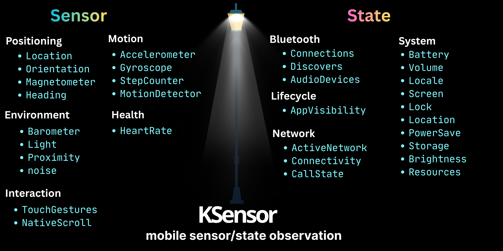

[](https://kotlinlang.org/)
[](https://gradle.org/)
[](https://opensource.org/licenses/0BSD)

<p align="center">
  
</p>

# KSensor

> [!TIP]
> **Ultra-Small App Footprint & Atomic Micro-Modules**: **KSensor supports granular, single-sensor micro-modules!** Instead of pulling in full domain bundles, you can depend **only** on the exact atomic sensor or state artifact you need (e.g. `ksensor-sensor-stepcounter`, `ksensor-state-system-battery`, `ksensor-sensor-accelerometer`). This **dramatically reduces your consumer app binary size**, **eliminates unused platform permissions**, and **prevents pulling in heavy transitive dependencies** (like Google Play Services or CameraX) when you don't need them!

KSensor is a Kotlin Multiplatform library for observing device sensors and system states. Each sensor or state is available as an **atomic micro-module** or grouped into **domain-level convenience facades**, allowing you to include only the features you need. This prevents pulling in unnecessary code and permissions.

All data emitted by plugins is wrapped in a `KSensorResponse<T>` which includes:
- `data`: The actual sensor or state data.
- `platform`: The platform type (Android or iOS).
- `timestamp`: The system time when the data was collected.

> [!NOTE]
> **Permissions**: Plugins declare structured permission metadata. You can auto-generate `AndroidManifest.xml` and iOS `Info.plist` permission snippets using `KSensor.permissionManifest()` and `KSensor.iosInfoPlistEntries()`. For complete details and examples, see [Permissions Handling](#permissions-handling).

---

## Core Module

The foundation of the library. It is required for all plugins.

Dependency:

```kotlin
implementation("io.github.shadadman:ksensor-core:version")
```

### Core Module API
```kotlin
object KSensor {
    /**
     * Flag to enable/disable "start on boot" for the entire library.
     */
    var startOnBoot: Boolean

    /**
     * Registers a plugin.
     * @param startOnBoot If true, this plugin will be marked to start automatically on device boot.
     */
    fun register(plugin: KSensorPlugin, startOnBoot: Boolean = false)

    /**
     * Unregisters a plugin.
     */
    fun unregister(id: PluginId)

    /**
     * Marks a plugin to start on boot or removes the mark.
     */
    fun setStartOnBoot(id: PluginId, enable: Boolean)

    /**
     * Starts all plugins marked as "start on boot". 
     * Used only in Application class on Android and to achieve "start on boot" behavior on iOS.
     */
    fun start()

    /**
     * Generates AndroidManifest.xml uses-permission tags snippet for registered or specified plugins.
     */
    fun permissionManifest(
        plugins: List<KSensorPlugin> = getRegisteredPlugins(),
        includeOptional: Boolean = true,
        includeComments: Boolean = true
    ): String

    /**
     * Generates iOS Info.plist usage description entries snippet for registered or specified plugins.
     */
    fun iosInfoPlistEntries(
        plugins: List<KSensorPlugin> = getRegisteredPlugins(),
        includeOptional: Boolean = true,
        includeComments: Boolean = true
    ): String

    /**
     * Debug utility that prints permission manifest entries for Android and iOS to stdout/console.
     */
    fun printPermissionManifests(
        plugins: List<KSensorPlugin> = getRegisteredPlugins()
    )
}
```

> [!IMPORTANT]
> **Android**: To use "Start on Boot", you must register your plugins and call `KSensor.start()` in your `Application` class. While the library handles the system boot broadcast automatically, calling `start()` in your application class ensures that observations are resumed whenever the app process is created.
>
> **iOS**: iOS does not allow arbitrary code execution on boot. To achieve "Start on Boot" behavior, you must call `KSensor.start()` in your `AppDelegate`'s `didFinishLaunchingWithOptions`. If you have background modes enabled (like Location or HealthKit), the system will relaunch your app into the background after a reboot, and calling `KSensor.start()` will resume observations.

---

# Sensors Plugins

These plugins provide access to hardware sensors for monitoring movement, environment, and health.

## Motion Sensors Plugin

Provides access to hardware sensors for tracking movement.

Dependencies:
```kotlin
// Option A: Domain Convenience Facade (Includes all motion sensors)
implementation("io.github.shadadman:ksensor-sensors-motion:version")

// Option B: Atomic Micro-Modules (Ultra-Small Footprint - Choose only what you need!)
implementation("io.github.shadadman:ksensor-sensor-accelerometer:version")
implementation("io.github.shadadman:ksensor-sensor-gyroscope:version")
implementation("io.github.shadadman:ksensor-sensor-stepcounter:version")
implementation("io.github.shadadman:ksensor-sensor-motiondetector:version")
```

Required Permissions:
- Android: `ACTIVITY_RECOGNITION` (Required for Step Counter & Motion Detector)
- iOS: `ACTIVITY_RECOGNITION` (Motion & Fitness)

### Android Configuration
Add the following to your `AndroidManifest.xml` if using Step Counter or Motion Detector:
- `android.permission.ACTIVITY_RECOGNITION`

### iOS Configuration
Add the following key to your `Info.plist` if using Step Counter or Motion Detector:
- `NSMotionUsageDescription`: Required for Step Counter and movement detection.

Data Models (Wrapped in `KSensorResponse`):

- Accelerometer: `Accelerometer(values: Vector3)`
- Gyroscope: `Gyroscope(values: Vector3)`
- Step Counter: `StepCounter(steps: Int)`
- Motion Detector: `MotionDetector(type: MotionType)` (Detects Walking, Running, Cycling, etc.)

## Environment Sensors Plugin

Provides data from sensors that monitor the ambient environment, such as pressure, light, proximity, and ambient noise.

Dependencies:
```kotlin
// Option A: Domain Convenience Facade
implementation("io.github.shadadman:ksensor-sensors-environment:version")

// Option B: Atomic Micro-Modules (Zero audio recording permission unless noise is imported!)
implementation("io.github.shadadman:ksensor-sensor-barometer:version")
implementation("io.github.shadadman:ksensor-sensor-light:version")
implementation("io.github.shadadman:ksensor-sensor-proximity:version")
implementation("io.github.shadadman:ksensor-sensor-noise:version")
```

Required Permissions:
- Android/iOS: `RECORD_AUDIO` (Only required if using the `Noise` plugin)

### Android Configuration
Add the following to your `AndroidManifest.xml` if you are using `Noise` plugin:
- `android.permission.RECORD_AUDIO`

### iOS Configuration
Add the following key to your `Info.plist` if you are using `Noise` plugin:
- `NSMicrophoneUsageDescription`: Required for ambient noise measurement.

Data Models (Wrapped in `KSensorResponse`):

- Barometer: `Barometer(pressure: Float)`
- Light: `LightIlluminance(illuminance: Float)`
- Proximity: `Proximity(distanceInCM: Float, isNear: Boolean)`
- Noise: `Noise(dB: Float, isLoud: Boolean, timestamp: Long?)`

## Positioning Sensors Plugin

Provides location services and spatial orientation data.

Dependencies:
```kotlin
// Option A: Domain Convenience Facade
implementation("io.github.shadadman:ksensor-sensors-positioning:version")

// Option B: Atomic Micro-Modules
implementation("io.github.shadadman:ksensor-sensor-location:version")
implementation("io.github.shadadman:ksensor-sensor-magnetometer:version")
implementation("io.github.shadadman:ksensor-sensor-orientation:version")
implementation("io.github.shadadman:ksensor-sensor-heading:version")
implementation("io.github.shadadman:ksensor-sensor-locationstatus:version")
```

Required Permissions:
- Android/iOS: `LOCATION` (Required for Location & Heading plugins)

### Android Configuration
Add the following to your `AndroidManifest.xml` if using Location or Heading:
- `android.permission.ACCESS_FINE_LOCATION`
- `android.permission.ACCESS_COARSE_LOCATION`

Data Models (Wrapped in `KSensorResponse`):

- Location: `Location(latitude: Double?, longitude: Double?, altitude: Double?)`
- Magnetometer: `Magnetometer(values: Vector3)`
- Orientation: `Orientation(orientation: DeviceOrientation, orientationInt: Int)`
- Heading: `Heading(magneticHeading: Double, trueHeading: Double, deviceHeading: Double, courseOverGround: Double)`
- Location Status: `LocationStatus(isLocationOn: Boolean)`

## Interaction Sensors Plugin

Provides high-level data related to user input gestures and scroll positions.

Dependencies:
```kotlin
// Option A: Domain Convenience Facade
implementation("io.github.shadadman:ksensor-sensors-interaction:version")

// Option B: Atomic Micro-Modules
implementation("io.github.shadadman:ksensor-sensor-touch:version")
implementation("io.github.shadadman:ksensor-sensor-scroll:version")
```

Required Permissions: None

Data Models (Wrapped in `KSensorResponse`):

- Touch Gestures: `TouchGestures(x: Float, y: Float, type: TouchGestureType)`
- Scroll: `ScrollStatus(horizontalPosition: Float, verticalPosition: Float, isScrolling: Boolean)` (via `scroll()`)

> [!NOTE]
> `scroll()` reports the position of the most recently scrolled native container (Android: `ScrollView`, `HorizontalScrollView`, `RecyclerView`, `ListView`, `WebView`, ...; iOS: any `UIScrollView`). Positions are in pixels on Android and points on iOS. `isScrolling` becomes `false` once scrolling has been idle for 300 ms. 
> 
> **Important:** This scroll observation is for native containers (`AndroidView` and `UIKitView`), **not** Jetpack Compose components. For Jetpack Compose, you can observe scroll position directly using `scrollState.value`.

## Health Sensors Plugin

Provides access to health related data.

Dependencies:
```kotlin
// Option A: Domain Convenience Facade
implementation("io.github.shadadman:ksensor-sensors-health:version")

// Option B: Atomic Micro-Module
implementation("io.github.shadadman:ksensor-sensor-heart:version")
```

Required Permissions:
- Android/iOS: `BODY_SENSORS`
- Android/iOS: `CAMERA`

### Android Configuration
Add the following to your `AndroidManifest.xml`:
- `android.permission.BODY_SENSORS`
- `android.permission.CAMERA`
- `android.permission.health.READ_HEART_RATE` (Optional: for Health Connect / API 36+)

### iOS Configuration
Add the following keys to your `Info.plist`:
- `NSCameraUsageDescription`: Required for Camera PPG.
- `NSHealthUpdateUsageDescription` & `NSHealthShareUsageDescription`: Required for HealthKit data.

Data Models (Wrapped in `KSensorResponse`):

- Heart Rate: `HeartRate(heartRate: Float, source: HeartRateSource, confidence: Float, quality: Float)`

### Fallback Strategy & PPG
The Health plugin implements a robust fallback strategy for heart rate detection on phones:
1. **Hardware Sensor**: 
   - Android: Uses the dedicated hardware heart rate sensor if available.
   - iOS: Uses **HealthKit** to retrieve the latest heart rate data (often from a paired Apple Watch).
2. **Camera PPG**: If no hardware sensor data is available, it falls back to **Photoplethysmography (PPG)**.

**What is PPG?**
PPG is a non-invasive method that uses a light source (the phone's flash) and a photodetector (the phone's camera) to measure the volumetric variations of blood circulation. By analyzing the "redness" of your finger over the camera lens, KSensor can estimate user heart rate with high precision using an advanced digital signal processing pipeline (Butterworth filters and adaptive peak detection).

---

# States Plugins

These plugins provide monitoring for various device system and connectivity states.

## Network States Plugin

Provides information about network connectivity and telephony call state on the device.

Dependencies:
```kotlin
// Option A: Domain Convenience Facade
implementation("io.github.shadadman:ksensor-states-network:version")

// Option B: Atomic Micro-Modules (Zero phone state permission unless CallState is imported!)
implementation("io.github.shadadman:ksensor-state-network-connectivity:version")
implementation("io.github.shadadman:ksensor-state-network-activenetwork:version")
implementation("io.github.shadadman:ksensor-state-network-callstate:version")
```

Required Permissions:
- Android: `READ_PHONE_STATE` (Only required if using `callState()`)
- iOS: None (Uses CallKit framework)

### Android Configuration
Add the following to your `AndroidManifest.xml` if using `callState()`:
- `android.permission.READ_PHONE_STATE`

Data Models (Wrapped in `KSensorResponse`):

- Connectivity: `ConnectivityStatus(isConnected: Boolean)`
- Active Network: `CurrentActiveNetwork(activeNetwork: ActiveNetwork)` (Values: WIFI, CELLULAR, NONE)
- Call State: `CallStateStatus(state: CallState, isInCall: Boolean)` (CallState values: IDLE, RINGING, OFFHOOK, UNKNOWN)

## System States Plugin

Provides access to general device system states like battery, volume, locale, screen, and resources.

Dependencies:
```kotlin
// Option A: Domain Convenience Facade
implementation("io.github.shadadman:ksensor-states-system:version")

// Option B: Atomic Micro-Modules
implementation("io.github.shadadman:ksensor-state-system-battery:version")
implementation("io.github.shadadman:ksensor-state-system-volume:version")
implementation("io.github.shadadman:ksensor-state-system-locale:version")
implementation("io.github.shadadman:ksensor-state-system-screen:version")
implementation("io.github.shadadman:ksensor-state-system-brightness:version")
implementation("io.github.shadadman:ksensor-state-system-lock:version")
implementation("io.github.shadadman:ksensor-state-system-powersave:version")
implementation("io.github.shadadman:ksensor-state-system-storage:version")
implementation("io.github.shadadman:ksensor-state-system-resources:version")
```

Required Permissions: None

Data Models (Wrapped in `KSensorResponse`):

- Battery: `BatteryStatus(levelPercent: Int?, chargingState: ChargingState, health: BatteryHealth?, temperatureC: Float?)`
- Volume: `VolumeStatus(volumePercentage: Int)`
- Locale: `LocaleStatus(languageCode: String, countryCode: String, fullLocaleString: String, displayName: String, isRTL: Boolean)`
- Screen: `ScreenStatus(isScreenOn: Boolean)`
- Brightness: `BrightnessStatus(screenBrightness: Int)`
- Lock: `LockStatus(isDeviceLocked: Boolean)`
- Power Save: `PowerSaveStatus(isPowerSaveMode: Boolean)`
- Storage: `StorageStatus(totalBytes: Long, usedBytes: Long, freeBytes: Long)`
- Resources: `ResourcesStatus(cpuUsagePercent: Double, appCpuUsagePercent: Double, systemLoadAverage: List<Double>, memoryPressure: MemoryPressureLevel, memoryUsage: MemoryUsage)`

## Bluetooth States Plugin

Provides monitoring for BLE connection and discovery events.

Dependencies:
```kotlin
// Option A: Domain Convenience Facade
implementation("io.github.shadadman:ksensor-states-bluetooth:version")

// Option B: Atomic Micro-Modules
implementation("io.github.shadadman:ksensor-state-bluetooth-connections:version")
implementation("io.github.shadadman:ksensor-state-bluetooth-discoveries:version")
implementation("io.github.shadadman:ksensor-state-bluetooth-audiodevices:version")
```

Required Permissions:
- Android/iOS: `BLUETOOTH`

### Android Configuration
Add the following to your `AndroidManifest.xml`:
- `android.permission.BLUETOOTH_SCAN` (API 31+)
- `android.permission.BLUETOOTH_CONNECT` (API 31+)
- `android.permission.ACCESS_FINE_LOCATION` (Required for discovery on older versions)

Data Models (Wrapped in `KSensorResponse`):

- BLE Connections: `BleConnectionStatus(connectedDevices: List<BleDevice>)`
- BLE Discoveries: `BleDiscoversStatus(discoveredDevices: List<BleDevice>)`
- BLE Device: `BleDevice(id: String, name: String)`

## Lifecycle States Plugin

Tracks the visibility and lifecycle state of the application.

Dependencies:
```kotlin
// Option A: Domain Convenience Facade
implementation("io.github.shadadman:ksensor-states-lifecycle:version")

// Option B: Atomic Micro-Module
implementation("io.github.shadadman:ksensor-state-lifecycle-appvisibility:version")
```

Required Permissions: None

Data Models (Wrapped in `KSensorResponse`):

- App Visibility: `AppVisibilityStatus(isAppVisible: Boolean)`

---

## Basic Usage

1. Register your plugin implementation.
2. Use the `KSensor` registry to retrieve the plugin and observe its data using Kotlin Flow.

Example to observe using `State`:
```kotlin
@Composable
fun OrientationSampleUsingState() {
    // Register a plugin
    val plugin = remember {
        KSensor.get<PositioningPlugin>(PluginId.POSITIONING)
            ?: createPositioningPlugin().also { KSensor.register(it) }
    }

    // Use state
    val orientation by plugin.orientation().collectAsState(null)

    println("OrientationData as state: ${orientation?.data}")
}
```
Example to observe using `Effect`:
```kotlin
@Composable
fun OrientationSampleUsingEffect() {
    // Register a plugin
    val plugin = remember {
        KSensor.get<PositioningPlugin>(PluginId.POSITIONING)
            ?: createPositioningPlugin().also { KSensor.register(it) }
    }

    // Use effect
    LaunchedEffect(plugin) {
        plugin.orientation().collect {
            println("OrientationData in effect: ${it.data}")
        }
    }
}
```

Example using Atomic Micro-Module directly:
```kotlin
// Directly observe step counter with minimal binary footprint!
val stepCounterPlugin = remember {
    createStepCounterPlugin().also { KSensor.register(it) }
}
val steps by stepCounterPlugin.observe().collectAsState(null)
```

Example to unregister a plugin:
```kotlin
KSensor.unregister(PluginId.POSITIONING)
```

---

## Permissions Handling

Some plugins require system permissions to function. Each plugin exposes a `requiredPermissions` list indicating what it needs, as well as `permissionMetadata` providing structured platform-level details (such as `minSdkVersion`/`maxSdkVersion` for Android and `Info.plist` usage description keys for iOS).

### Auto-Generated Permission Manifest Templates

Instead of manually writing `AndroidManifest.xml` tags and iOS `Info.plist` usage descriptions, KSensor provides pure helper functions in the Core module to generate template-ready permission entries for all registered plugins (or a specified list of plugins).

```kotlin
// Generate AndroidManifest.xml uses-permission tags
val androidManifestSnippet: String = KSensor.permissionManifest(
    includeOptional = true,
    includeComments = true
)

// Generate iOS Info.plist usage description entries
val iosInfoPlistSnippet: String = KSensor.iosInfoPlistEntries(
    includeOptional = true,
    includeComments = true
)

// Debug utility to print permission entries for all registered plugins to console
KSensor.printPermissionManifests()
```

---

## License

Copyright (c) 2026 KSensor

Permission to use, copy, modify, and/or distribute this software for any purpose
with or without fee is hereby granted.

THE SOFTWARE IS PROVIDED "AS IS" AND THE AUTHOR DISCLAIMS ALL WARRANTIES
WITH REGARD TO THIS SOFTWARE INCLUDING ALL IMPLIED WARRANTIES OF
MERCHANTABILITY AND FITNESS. IN NO EVENT SHALL THE AUTHOR BE LIABLE FOR
ANY SPECIAL, DIRECT, INDIRECT, OR CONSEQUENTIAL DAMAGES OR ANY DAMAGES
WHATSOEVER RESULTING FROM LOSS OF USE, DATA OR PROFITS, WHETHER IN AN
ACTION OF CONTRACT, NEGLIGENCE OR OTHER TORTIOUS ACTION, ARISING OUT OF
OR IN CONNECTION WITH THE USE OR PERFORMANCE OF THIS SOFTWARE.
